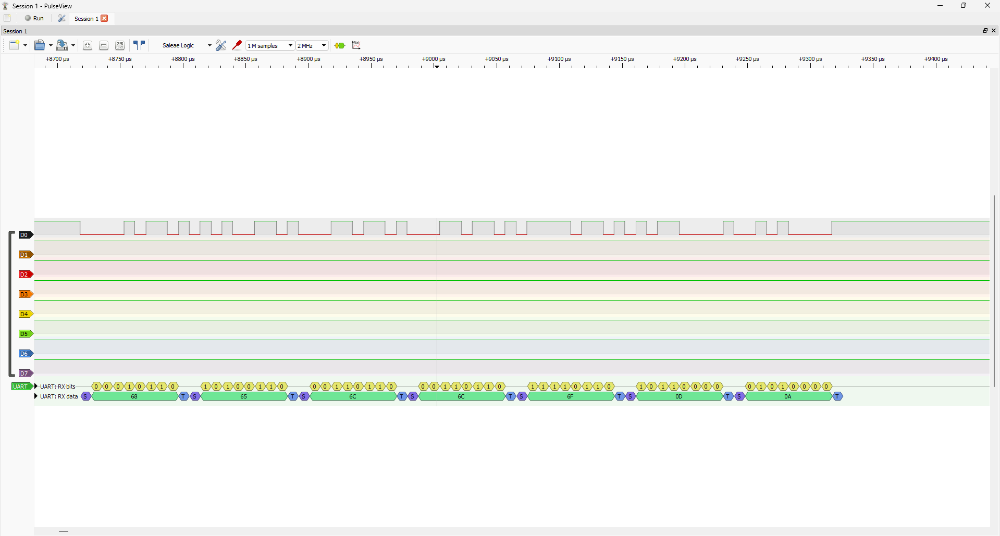

# stm32-baremetal

Register-level firmware for the **STM32G071RB** (Arm Cortex-M0+, Nucleo-G071RB board),
written without HAL, LL or CubeMX code generation. Every peripheral is configured directly
through the registers described in the reference manual (RM0444), using only the CMSIS
device header for register and bit names.

The goal is to understand each peripheral from first principles and build up to larger
projects on top of these drivers: an embedded command-line interface, a CAN telemetry
network, a triple-modular-redundancy (TMR) fault-voting demo and a black-box data logger.

## Status

| Driver | Mode | Status | Verified on |
|---|---|---|---|
| USART2 TX | Polling | Done | ST-LINK virtual COM port + logic analyzer |
| USART2 RX | Polling / interrupt + ring buffer | Next | |
| I2C (MPU6050 IMU) | | Planned | |
| SPI (microSD, MCP2515) | | Planned | |
| CAN via MCP2515 | | Planned | Two-node bus |
| DMA | | Planned | |

### USART2 TX

115200 baud, 8N1, from the 16 MHz HSI16 clock (BRR = 139, -0.08 % baud error).
"hello\r\n" decoded on the TX line (PA2) with a logic analyzer in PulseView:
`68 65 6C 6C 6F 0D 0A`, LSB first, ~86 µs per byte, no idle gap between bytes.



## Hardware

- NUCLEO-G071RB (STM32G071RB, 128 KB flash, 36 KB RAM, silicon revision Y)
- 8-channel USB logic analyzer, multimeter
- Modules for later drivers: MPU6050, microSD, GPS, 2× MCP2515 + TJA1050 CAN, Arduino Due

Pin assignments, voltage levels and board notes: [`docs/HARDWARE.md`](docs/HARDWARE.md).

## Build and flash

Requirements: `arm-none-eabi-gcc` (tested with GCC 14.3 from STM32CubeCLT 1.22), CMake ≥ 3.20, Ninja.

```sh
cmake --preset debug
cmake --build --preset debug
```

Output: `build/debug/firmware.elf`, `.hex` and `.bin`. Flash and debug through the on-board
ST-LINK, e.g. with the ST-LINK GDB server from STM32CubeCLT or STM32CubeProgrammer.

## Repository layout

```
src/            application entry point (main.c)
drivers/        peripheral drivers, one .h/.c pair per peripheral
startup/        vector table and reset handler (CMSIS template)
linker/         linker script for 128 KB flash / 36 KB RAM
cmake/          arm-none-eabi toolchain file
third_party/    unmodified CMSIS core and STM32G0 device headers (Apache-2.0)
docs/           hardware notes, design decisions, development log
docs/results/   verification captures (logic analyzer, terminal output)
```

## Documentation

- [`docs/DECISIONS.md`](docs/DECISIONS.md): why things are done the way they are
- [`docs/DEVLOG.md`](docs/DEVLOG.md): what was built, what broke, what is next

## Development workflow

AI coding assistants (Claude Code, OpenCode) are used in this repository. The rules they
follow are in [`AGENTS.md`](AGENTS.md): the first driver for every protocol is written by
hand, register-level changes are checked by read-only review agents against the reference
manual and the silicon errata, and every change is verified on hardware.

## License

MIT for the code in this repository. Files under `third_party/` keep their original
Apache-2.0 licenses.
